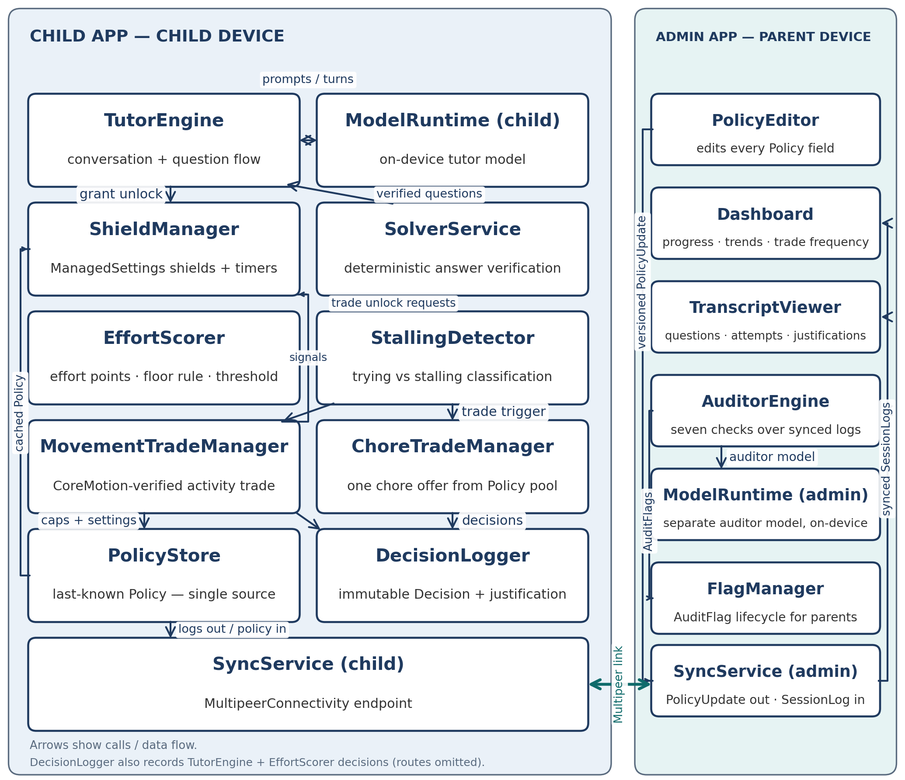
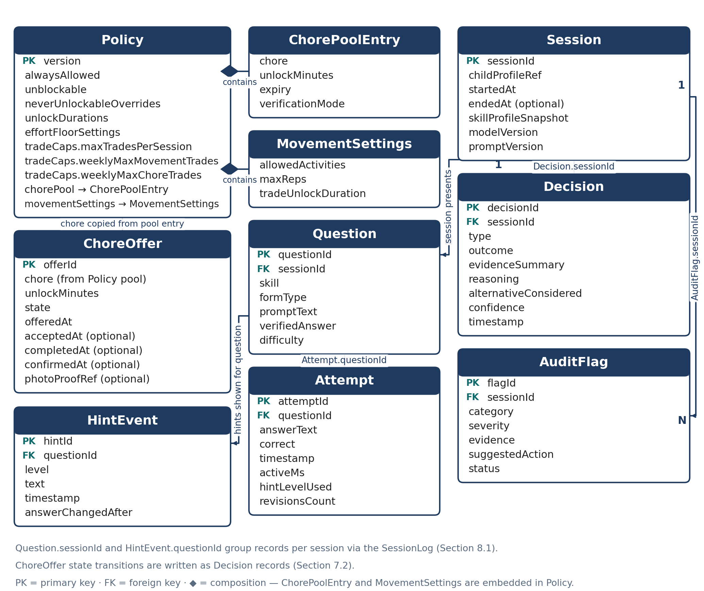
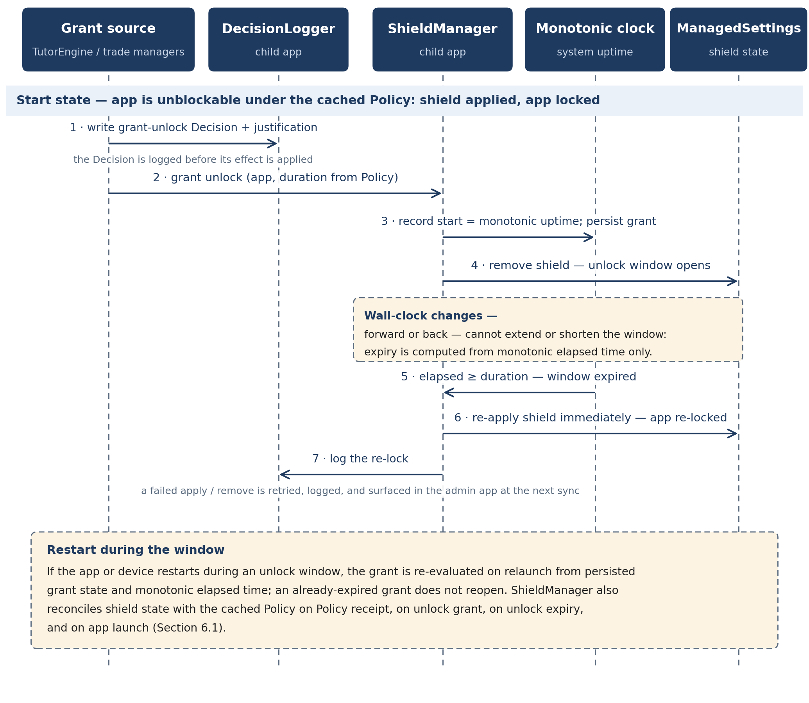

**EARNPLAY • iOS • ON-DEVICE AI**

**EarnPlay --- High-Level Design**

*A private, on-device tutor and motivation engine for kids*

> **One-liner ---** *An on-device AI tutor and motivation engine for kids that is never trusted alone --- deterministic code holds every safety-critical decision, every AI decision is justified and checked by a second AI auditor --- where practice, movement, and chores earn screen time. No child data ever leaves the device.*

  ----------------------------------------------------------------------------------------------------------------------------------------------------------------------------
  **Item**                            **Detail**
  ----------------------------------- ----------------------------------------------------------------------------------------------------------------------------------------
  Document                            High-Level Design (HLD). Companion document: Low-Level Design (LLD), which carries field-level schemas, state machines, and protocols.

  Product                             EarnPlay --- two iOS apps: a child app and an admin (parent) app. iOS only.

  Audience                            The solo builder (Indie track) and hackathon reviewers.

  Status                              Design for the 10-day hackathon demo, with v1 and Future scope explicitly separated.

  Reading note                        Anything not in the 10-day demo is marked v1 or Future in the text and in Section 10.
  ----------------------------------------------------------------------------------------------------------------------------------------------------------------------------

**How to read this document.** Sections 1--3 set out what EarnPlay is and who it serves. Section 4 describes the system as components and responsibilities, with no code. Section 5 walks through the core flows. Sections 6--8 cover data, privacy, and AI design at a high level. Sections 9--12 name the platform constraints, the exact demo / v1 / Future boundary, the CI/CD and release process, and the risks with their mitigations. Field-level schemas, thresholds, and protocol details are deliberately left to the LLD.

# 1 Purpose and scope \[HLD-purpose-and-scope\]

This High-Level Design describes EarnPlay at the system level: the architecture and component responsibilities, the core user flows, the data the system holds, the privacy and security principles, the AI design, and the platform constraints that shape every choice. It is the document a reviewer can read to judge whether the idea is coherent, feasible, and safe, and the document the builder works from day to day during the build.

In scope for this HLD are the two-app structure, the locking model, the challenge and trade flows, the Bluetooth sync and audit loop, the division of authority between AI models and deterministic code, and the boundary between the 10-day demo, the first full release (v1), and Future work. Out of scope --- and reserved for the Low-Level Design --- are field-level data schemas, exact scoring formulas and thresholds, prompt text, sync message formats, and any code or API signatures.

The intended audience is deliberately small: the solo builder on the Indie track, who needs a design that can be built and tested by one person, and hackathon reviewers, who need to assess clarity, feasibility, and fit to the theme without reading implementation detail. The design therefore favors a narrow, demonstrable demo slice over breadth, and makes every deferral explicit rather than implied.

## What this document does not do \[HLD-what-this-document-does-not-do\]

- It does not specify fields, types, or storage layouts. Data appears in Section 6 as entities and purposes only.

- It does not set numeric thresholds for effort, timing, or caps. Those values are policy and tuning decisions detailed in the LLD.

- It does not promise features beyond those named here. Where a capability is marked v1 or Future, it is not part of the demo.

# 2 Product overview \[HLD-product-overview\]

EarnPlay is a private, on-device tutor and motivation engine for elementary-school children. A child practices math and reading in short, interactive challenges; genuine effort --- not perfect answers --- earns timed access to apps the parent has chosen. Movement and chores are two additional, AI-offered ways to earn the same unlock. All inference runs on the device, and no child data ever leaves the device.

## Two apps, two jobs \[HLD-two-apps-two-jobs\]

The child app is the tutor, the app locker, and the challenge gate. It enforces the last-known policy on the child\'s device: it presents challenges, judges effort, manages shields, verifies movement, tracks chore completion, and logs every decision with its justification. If the admin app is never opened again, the child app continues to enforce correctly on its own.

The admin (parent) app sets policy and reviews what happened. The parent picks which apps sit in each locking tier, sets challenge parameters and chore offers, reads progress and full transcripts, and reviews flags raised by the auditor. The admin app enforces nothing directly on the child\'s device; it sends policy to the child app, and the child app does the enforcing.

## The three locking tiers \[HLD-the-three-locking-tiers\]

{width="6.6in" height="3.2093700787401573in"}

> *Figure 1 --- The three locking tiers. Only unblockable apps can be earned open; the other tiers are either always open or stay locked with no challenge offered.*

  ------------------------------------------------------------------------------------------------------------------------------------------------------------------------------------------------------------------------------------------------
  **Tier**                **Meaning**                                                                                                  **How it opens**
  ----------------------- ------------------------------------------------------------------------------------------------------------ -----------------------------------------------------------------------------------------------------------
  Always-allowed          Never blocked. EarnPlay itself, Phone, and Messages by default, plus any additional apps the parent picks.   Always open. No challenge is offered or required.

  Unblockable             Locked by default. Only the apps the parent picks for this tier.                                             The only apps a challenge, movement trade, or chore trade can open --- for a set time, then they re-lock.

  Locked, no challenge    Everything else, by default.                                                                                 Stays locked. No challenge is offered for these apps.
  ------------------------------------------------------------------------------------------------------------------------------------------------------------------------------------------------------------------------------------------------

Newly installed apps are locked by default. An app does not become earnable because it appeared on the device; a parent must deliberately place it in the unblockable tier at the next sync. Unlocks reward effort, not perfection: a child who works genuinely at a challenge can earn the unlock without answering everything correctly, and a child who does not engage earns nothing. That distinction --- effort over correctness --- is the product\'s central promise, and the AI design in Section 8 exists to make it trustworthy.

# 3 Users and key scenarios \[HLD-users-and-key-scenarios\]

## Users \[HLD-users\]

- **Child.** The child --- an elementary-school learner, with a 4th-grade level focus for content and difficulty. The child interacts only with the child app: practice, hints, trade offers, and unlocks.

- **Parent.** The parent --- the policy owner and reviewer. The parent uses the admin app to authorize Screen Time access at setup, place apps into tiers, set challenge parameters, stock the chore pool, and review transcripts, progress, decision justifications, and auditor flags.

There are no other roles. There are no accounts, no teacher or school role, and no remote administrator. The two devices and the Bluetooth link between them are the whole system.

## Key scenarios \[HLD-key-scenarios\]

  --------------------------------------------------------------------------------------------------------------------------------------------------------------------------------------
  **\#**                  **Scenario**                          **What must be true**
  ----------------------- ------------------------------------- ------------------------------------------------------------------------------------------------------------------------
  S1                      Setup and Screen Time authorization   Parent authorizes access on the child\'s device, picks tiers, and the child app begins enforcing.

  S2                      Challenge leads to unlock             Child engages genuinely, effort is recognized, an unblockable app opens for a set time and then re-locks.

  S3                      Idle or guessing earns no unlock      Low-effort behavior is recognized as such; no unlock is granted and the reasoning is logged.

  S4                      Movement trade                        When motivation fades, the AI offers a verified physical activity in exchange for a shorter unlock.

  S5                      Chore trade                           The AI offers one chore from the parent-stocked pool; the parent confirms completion and the unlock is granted.

  S6                      Parent review and audit               Parent reads the transcript and decision log, and sees auditor flags with evidence where the tutor may have misjudged.
  --------------------------------------------------------------------------------------------------------------------------------------------------------------------------------------

Scenarios S2 and S3 are a pair by design: the same challenge machinery must be able to say yes to hard trying with wrong answers and no to idling with occasional correct guesses. A design that can only do one of the two has not solved the core problem.

# 4 System architecture \[HLD-system-architecture\]

{width="6.6in" height="4.9345395888014in"}

> *Figure 2 --- System architecture. Policy moves down from the admin app to the child app and logs move up over Bluetooth; the on-device AI layer proposes, the deterministic layer decides, and ManagedSettings enforces the shields.*

EarnPlay is organized in four layers. The child app and the admin app each contain application components. Beneath them sits an on-device AI layer --- a tutor model in the child app and a separate auditor model in the admin app. Cutting across both apps is a deterministic layer of solvers, rule gates, and allowlists. At the bottom are the iOS platform services the system depends on. The layers matter because authority flows in one direction: the AI layer proposes, and the deterministic layer decides.

> **Trust rule ---** The models propose, deterministic code disposes. The tutor model can suggest a question, a hint, a judgment about effort, or a trade offer. It cannot grant an unlock, change policy, lift a shield, or override a verified answer. Every safety-critical decision --- whether an answer is correct, whether an unlock is granted, which apps may open, and for how long --- is held by deterministic code.

## Child app components \[HLD-child-app-components\]

  -------------------------------------------------------------------------------------------------------------------------------------------------------------------------------------------
  **Component**                       **Responsibility**
  ----------------------------------- -------------------------------------------------------------------------------------------------------------------------------------------------------
  Tutor Engine                        Runs the interactive practice session: diagnostic, adaptive questions, conversation, and the hint ladder.

  Solver                              Deterministically verifies answers before the child sees a question\'s expected result; the correctness authority for math and passage-bound reading.

  Effort Scorer                       Assesses genuine effort from session evidence --- active time, attempts, hint use, revisions, and explanations --- and proposes unlock or no unlock.

  Shield Manager                      Applies and removes shields via ManagedSettings according to tier and unlock state; owns timed unlock and re-lock.

  Trade Managers                      Handle movement trades (motion-verified) and chore trades (offer, acceptance, completion state) under caps and AI initiation.

  Policy Store                        Holds the last-known policy locally and makes it available offline; the enforcement source of truth on the device.

  Sync (child side)                   Exchanges policy down and logs up with the admin app over Bluetooth when both apps are open and nearby.

  Decision Logger                     Records every significant decision with its evidence, reasoning, alternative considered, and confidence.
  -------------------------------------------------------------------------------------------------------------------------------------------------------------------------------------------

## Admin app components \[HLD-admin-app-components\]

  --------------------------------------------------------------------------------------------------------------------------------------------------
  **Component**                       **Responsibility**
  ----------------------------------- --------------------------------------------------------------------------------------------------------------
  Policy Editor                       Tier placement, challenge parameters (question count, pass approach, unlock duration), chore pool, and caps.

  Dashboard                           Progress at a glance: practice, skills over time, unlocks earned, and trade frequency.

  Transcript Viewer                   Full questions, answers, hints, and session history for parent review.

  Auditor Engine                      Runs the auditor model over synced logs and cross-checks justifications against the raw record.

  Flag Manager                        Presents audit flags with severity, evidence, and a suggested action; tracks parent acknowledgment.

  Sync (admin side)                   Sends policy down and receives logs up over Bluetooth; the only channel between the two apps.
  --------------------------------------------------------------------------------------------------------------------------------------------------

## On-device AI layer \[HLD-on-device-ai-layer\]

The tutor model lives in the child app and works interactively, in the moment of practice. The auditor model lives in the admin app and works in batch, after the fact, over completed logs. They are separate models in separate apps on separate devices, which is the point: the system that judges the child is not the system that judges the judge. Neither model makes network calls at practice time, and neither model holds a safety-critical decision. Section 8 describes both models and the assurance layers around them.

## Deterministic layer \[HLD-deterministic-layer\]

The deterministic layer is plain code with testable rules: the solver that verifies answers, the rule gates that convert an effort proposal into a granted or denied unlock, the tier allowlists that define which apps can ever open, the timers that bound an unlock, and the caps that bound trades. If the AI layer and the deterministic layer disagree, the deterministic layer wins. This layer is what makes the product\'s promises checkable rather than aspirational.

## Platform services \[HLD-platform-services\]

- **FamilyControls.** Provides authorization and the opaque app and category tokens the parent picks from. EarnPlay never learns the child\'s installed apps beyond those picks.

- **ManagedSettings.** Applies the shields that block apps and categories, and lifts them for a timed unlock on unblockable apps only.

- **CoreMotion.** Verifies physical activity for movement trades, with the phone carried by the child during the activity.

- **MultipeerConnectivity.** Carries Bluetooth sync between the two apps when both are open and nearby. There is no server and no cloud relay.

Component interactions follow from the flows in Section 5: policy moves only from admin to child, logs move only from child to admin, shields change only inside the child app, and audit happens only inside the admin app.

# 5 Core flows \[HLD-core-flows\]

*Each flow below is described as a sequence of steps in one paragraph. Thresholds, timers, and message formats are LLD detail and are intentionally not specified here.*

### 5.1 Setup and authorization \[HLD-setup-and-authorization\]

The parent installs both apps, opens the child app on the child\'s device, and completes Apple\'s Screen Time authorization, which is what allows EarnPlay to apply shields at all. Using the system app picker on the child\'s device, the parent places apps into the three tiers --- always-allowed, unblockable, and locked --- and EarnPlay receives only opaque tokens for those picks. The parent then sets the initial challenge parameters and, optionally, stocks the chore pool in the admin app. At the first Bluetooth sync, the policy moves to the child app, the child app stores it as the last-known policy, applies shields accordingly, and enforcement begins. Setup also documents enabling the Screen Time setting that prevents deleting apps, so the child app itself cannot simply be removed to bypass the system (see Section 12).

### 5.2 Challenge, timed unlock, and re-lock \[HLD-challenge-timed-unlock-and-re-lock\]

{width="6.6in" height="4.806591207349081in"}

> *Figure 3 --- Challenge-to-unlock sequence. A tap on a shielded unblockable app leads through a Solver-verified challenge and an effort judgment to a timed unlock, which re-locks automatically when the timer expires.*

The child taps an unblockable app and meets the shield, opens EarnPlay, and starts a challenge at the difficulty the diagnostic and prior sessions have established. The Tutor Engine asks questions in varied, non-textbook forms, converses, and offers hints from a ladder as needed; the Solver verifies each math answer before it is used, and reading questions are checked against their passage. Throughout the session the Effort Scorer watches the evidence --- active engagement, attempts, hint use, revisions, and explanations --- rather than the score alone. When the deterministic rule gate accepts the effort proposal, the Shield Manager lifts the shield on the requested unblockable app for the policy\'s unlock duration; when the time expires, the shield returns automatically. Every step, including a denial, is written to the Decision Logger with its justification.

### 5.3 Movement trade \[HLD-movement-trade\]

A movement trade begins only when the AI initiates it --- the child cannot request one on demand. When the tutor detects that the child wants the unlock but motivation or patience is failing, it may offer a single trade: a verified physical activity, such as jumping jacks or running in place, in exchange for an unlock. The child accepts or declines; if they accept, CoreMotion verifies the activity with the phone carried in a pocket, and a completed activity earns an unlock that is shorter than a practice-earned unlock. Offers and grants are frequency-capped, and the choice to offer movement, offer a chore, or offer nothing is varied so the pattern cannot be learned and gamed. The trade, its evidence, and its reasoning are logged and visible in the admin app.

### 5.4 Chore trade \[HLD-chore-trade\]

A chore trade uses the same AI-initiated moment as the movement trade, but the offer is one chore drawn from the pool the parent stocked in the admin app --- each with its unlock minutes, expiry, caps, and verification mode. The child sees a single take-it-or-leave-it offer, never a browsable list to shop from. If the child accepts and does the chore, completion is confirmed by the parent, who is the only party who can judge whether a room is actually clean, and the unlock is granted on confirmation. An optional asynchronous mode (v1) lets the child submit photo proof and continue, with the parent reviewing later and able to revoke if the proof does not hold up. Challenge and movement unlocks require no parent approval; the chore path involves the parent because the parent offered the chore and owns its verification --- those are different mechanisms, not an exception.

### 5.5 Sync and audit \[HLD-sync-and-audit\]

When both apps are open and the devices are nearby, the two Sync components connect over Bluetooth and exchange in both directions: new policy moves down from admin to child, and new session logs, transcripts, and decision justifications move up from child to admin. The child app then enforces the new policy, including tier changes, from that moment. On the parent\'s device, the Auditor Engine runs over the newly arrived logs in batch: it compares every justification against the raw session record and raises AuditFlags for the patterns listed in Section 8 --- leniency drift, false negatives, gaming, miscalibration, behavior shifts, inconsistency, and justifications that do not match the evidence. The parent reviews transcripts and flags in the admin app; nothing in this flow leaves either device.

### 5.6 Offline enforcement \[HLD-offline-enforcement\]

Enforcement never depends on connectivity. The child app caches the last-known policy in its Policy Store and applies shields, challenges, trades, and timers entirely locally, with on-device inference and no network calls at practice time. If the devices do not sync for days, the child experiences no gap and no loosening: the last policy the parent set is the policy that holds. New policy simply waits in the admin app until the next time both apps are open and nearby. Decision logs accumulate locally in the meantime and sync up when the connection next occurs, so the audit trail has no offline hole.

# UX design \[HLD-ux-design\]

This section describes what the child and the parent actually see: the screens in each app, the layout of the screens that carry the product\'s core loop, the kids-UX principles every screen follows, and the accessibility baseline. It specifies screens and behavior, not visual styling --- colors, artwork, and exact typography are build-time choices within the principles below. Nothing in this section changes the authority rules set out earlier: unlocks reward genuine effort and are never pass/fail (Sections 2 and 5.2), only unblockable apps can be earned open, and shields are applied by the Shield Manager through ManagedSettings on the enumeration-first model described in Section 9 --- at setup every app except the always-allowed list is shielded, with category shields as the backstop for newly installed apps.

Two audiences, two reading levels. Child-facing screens are written for an elementary-school reader and follow the kids-UX principles in this section without exception. Admin-facing screens are written for an adult, but keep the same plain-language rule: every label says what it does, and no screen in either app is a dead end.

## Grade bands \[HLD-grade-bands\]

EarnPlay targets grades 1--5, but a single presentation does not fit that whole span: a child who is still learning to read and an older elementary reader need different amounts of text, different answer inputs, and different session lengths. This section therefore works in two grade bands, and the grade parameter --- the child\'s grade, held in the data model and set at setup --- selects the band. The grade parameter drives band-specific UX behavior throughout this section: read-aloud, answer input, UI copy, visual tone, screen density, and session length all follow the band, while the underlying screens, flows, and authority rules stay the same in both bands.

**Band A --- grades 1--2.** Band A covers grades 1--2 --- early readers, roughly ages 6--7. Children in this band are still building basic reading fluency, so the interface carries more of the reading load for them: text is read aloud by default, answers are chosen or tapped rather than typed, screens hold fewer elements at once, and sessions are shorter.

**Band B --- grades 3--5.** Band B covers grades 3--5 --- fluent and transitional readers, roughly ages 8--11. Children in this band can read questions and hints independently, can type as well as choose answers, and can sustain longer sessions. The demo\'s 4th-grade screens are Band B screens: grade 4 sits in Band B, and the demo ships 4th-grade content only (see Section 10).

## Screen inventory \[HLD-screen-inventory\]

Every screen in the two apps is listed below, grouped by app, with one line of purpose and its scope. Scope follows Section 10 exactly: Demo is the 10-day demo, v1 completes the product, and Future is deferred. A screen marked "Demo, completed in v1" appears in the demo in the form the demo moments need and reaches its full form in v1.

  ------------------------------------------------------------------------------------------------------------------------------------------------------------------------------------
  **Child app screen**               **Purpose**                                                                                                               **Scope**
  ---------------------------------- ------------------------------------------------------------------------------------------------------------------------- -----------------------
  Diagnostic                         Short opening check that sets the starting difficulty for math and reading.                                               Demo

  Challenge                          The main practice screen: a chat conversation with the AI tutor. Questions, hints, probes, encouragement, answers, and revisions all flow as messages in the thread.                                                                                          Demo

  Hint display                       Hints arrive as tutor messages in the chat thread, one ladder level at a time, without revealing the answer.                                                                                                                                                    Demo

  Shield                             What the child meets on opening a locked app: a plain explanation and, for unblockable apps only, the way to earn time.   Demo

  Unlock countdown                   Shows the time left on an earned unlock and what happens when it ends.                                                    Demo

  Movement trade                     A single AI-offered activity trade: accept or decline, then the motion-verified activity in progress.                     Demo, completed in v1

  Chore trade offer                  A single AI-offered chore from the parent-stocked pool: accept or decline, with no list to browse.                        Demo, completed in v1

  Session complete / encouragement   Closes a session with an encouraging summary of the effort made and the unlock result.                                    Demo
  ------------------------------------------------------------------------------------------------------------------------------------------------------------------------------------

  ----------------------------------------------------------------------------------------------------------------------------------------------------------
  **Admin app screen**         **Purpose**                                                                                           **Scope**
  ---------------------------- ----------------------------------------------------------------------------------------------------- -----------------------
  App picker and policy list   Parent places apps into the three tiers using the system picker and reviews the current policy.       Demo

  Challenge settings           Parent sets question count, the effort-based pass approach, and unlock duration.                      Demo

  Progress dashboard           Parent sees practice, skill trends, effort trend, unlocks earned, and trade frequency at a glance.    Demo

  Session transcript           Full questions, answers, hints, and tutor interaction for one session, for parent review and audit.   v1

  Auditor flags                Auditor findings with severity, evidence, and a suggested action, for parent review.                  Demo, completed in v1

  Decision log                 Every significant decision with its evidence, reasoning, alternative considered, and confidence.      v1

  Chore pool editor            Parent stocks and edits the chore pool: chore, unlock minutes, expiry, caps, and verification mode.   Demo, completed in v1
  ----------------------------------------------------------------------------------------------------------------------------------------------------------

How the "completed in v1" screens work. The demo shows the movement trade, the chore trade offer, and one staged auditor flag --- the demo moment in which the auditor catches a planted leniency error --- in the form those moments need. Version 1 completes them: movement verification and caps in full, chore trades including the asynchronous photo-proof mode, and the complete auditor flag set running over real usage history. The full, browsable Session transcript and Decision log are v1; in the demo, the transcript excerpt and justification attached to the staged flag are what the parent sees. No screen in this inventory is Future-only: the Future capabilities in Section 10 (a parent-selectable audit endpoint, multi-child support, speech scoring, a fuller curriculum, opt-in cloud sync) extend these screens rather than adding new ones.

**Grade-band note on scope.** Band A variants are v1 scope. The Band A variants of the Diagnostic, Challenge, and Hint display screens --- with auto-read-aloud, picture and tap-to-choose answers, and the sparser Band A layout described in the Kids-UX principles below --- are v1 scope. They are variants of the same screens, not new screens, so the inventory above is unchanged. The demo\'s Diagnostic, Challenge, and Hint display screens are the Band B versions, because the demo ships 4th-grade content only. One piece of the Band A experience is Demo scope rather than v1: the read-aloud infrastructure itself --- the speaker button and on-device text-to-speech behind it --- is Demo scope, because the demo\'s tutor voice benefits even a 4th-grade reader.

## Key screen descriptions \[HLD-key-screen-descriptions\]

Four screens carry the product\'s argument and are described here in words, in enough detail to build from. Each description reads top to bottom, as the screen is laid out. Measurements, colors, and artwork are deliberately left to the build within the principles in the next subsection.

**Challenge screen (chat).** The main screen is a chat conversation with the AI tutor, laid out as a message thread. At the top sits a slim session header: the star progress indicator --- one star per question in the session, filling as each is attempted --- and nothing else: no score, no clock. Below it is the message thread itself, scrolling: tutor messages on one side, the child's on the other. A question arrives as a tutor message with the problem in large type, with a picture or worked visual where the question has one; for a reading question, the short passage first and the question beneath it. The child answers in the composer at the bottom --- typing, tapping choice buttons, or using the number pad, matched to the question type and grade band. The Hint button sits beside the composer, always visible, labeled in words, never disabled; tapping it delivers the next hint-ladder level as a tutor message in the thread. A wrong answer never produces a failure state: the tutor responds in the thread with encouragement, a hint is offered, and the child tries again. Follow-up probes ("show me one step") arrive as tutor messages; the child's reply is a chat message. Every tutor message carries a speaker button for read-aloud (auto-read in Band A). There is no clock, no countdown, and no visible score anywhere on the screen, and the effort judgment is never shown as a number.

**Shield screen.** The shield is what iOS presents when the child taps a locked app, configured by the Shield Manager through ManagedSettings; EarnPlay sets its content within the options the platform provides, and the exact configuration is LLD detail. The child sees the app\'s name and icon and one short sentence in plain words saying the app is locked --- for example, that it is taking a break --- with nothing else competing for attention. What appears next depends on the tier, and the difference is the product in miniature. For an unblockable app, the shield adds one clear next step in words: close this screen and open EarnPlay to earn time with a challenge. For a locked, no-challenge app, there is no earning path and none is hinted at --- only the locked message and a way to close. Always-allowed apps never show a shield at all, and an unblockable app inside an earned unlock opens normally, with no shield. The shield never shows a score, a reason tied to the child\'s past behavior, or a timer.

**Unlock countdown.** When an unlock is earned, the child app shows the countdown as a card at the top of its home screen and keeps it there for as long as the unlock is active. The card names the unlocked app, shows the time remaining as large numerals in minutes, and pairs the numerals with a visual meter --- a bar or ring that empties as time passes --- so a child who reads numbers slowly still sees how much time is left. Under the meter, one short sentence says what happens at the end: when the time runs out, the app locks again, and more time can be earned later. There is no button to extend the unlock or ask for more time; earning more time means a new challenge, trade, or chore after this unlock ends. At expiry the Shield Manager re-applies the shield automatically and access simply ends. The next time the child opens EarnPlay, the session complete screen notes in encouraging words that the earned time was used. If the child opens EarnPlay during an unlock, the countdown card stays visible at the top and practice remains fully available.

**Admin progress dashboard.** The admin app\'s home screen is a single scrolling column of stacked cards, ordered from summary to detail. At the top, three summary cards show practice sessions this week, unlocks earned, and trades used. Below them is the skill-trends card: one simple chart per subject --- math and reading --- showing the child\'s level over time as a line the parent can read as rising, steady, or dipping, with the axis labeled in plain words (for example, "Last 6 weeks") rather than raw scores. Next is the effort-trend card: a visual trend of genuine engagement across sessions --- active time, attempts, and hint use summarized as a direction, not a grade --- so the parent sees trying over time, which is what the product rewards. Below that, the trade-frequency card breaks earned unlocks down by how they were earned --- practice, movement trades, and chore trades --- as counts with labeled bars, so a drift toward trades and away from practice is visible at a glance. At the bottom, a recent-sessions list leads to the Session transcript for any session, and a flags summary shows the count of unreviewed auditor flags and leads to the Auditor flags screen. Before the first sync, the dashboard shows an empty state in plain words explaining that progress will appear after the child\'s device has synced, and what to do to sync.

**Grade-aware effort reading.** Effort is not read the same way in both bands, because the evidence a child can produce differs by age. In Band A, the AI weights retries, hint-listens --- the child choosing to hear a hint read aloud and then acting on it --- and repeated attempts over verbal explanations as effort signals: a 6- or 7-year-old who keeps trying, listens to help, and revises an answer is showing genuine effort even if they cannot yet explain their thinking in words, and the system must not treat a short or missing explanation as low effort. In Band B, verbal explanation signals apply fully: an older child explaining how they got an answer, in speech or writing, is strong evidence of genuine engagement, and it is weighed alongside attempts, hint use, and revisions. The rule gates and the unlock decision itself do not change between bands --- only the weighting of the evidence feeding the effort judgment changes, and every such judgment is still logged with its evidence as Section 8 requires.

## Kids-UX principles \[HLD-kids-ux-principles\]

These principles bind every child-facing screen, including screens not described above. Where a platform default and a principle conflict, the principle wins and the difference is noted in the LLD.

- **Big tap targets.** Every interactive element is at least 44 × 44 points, primary actions are larger, and targets are spaced so a missed tap lands on empty space rather than the wrong control.

- **Short text at a 4th-grade reading level.** One idea per sentence, common words, no jargon, and no instruction longer than a child can read in a few seconds. Tutor and system copy is checked against a 4th-grade reading level before it ships.

- **Progress shown visually, never as raw scores.** Session progress is stars, meters, and filling shapes. There are no raw scores, percentages, or grades anywhere in the child app, and the effort score behind the unlock judgment is never shown to the child --- it is an internal signal for the Effort Scorer and the rule gates, visible to the parent only through the dashboard trend and the Decision log.

- **Effort narrated in encouraging words.** Feedback names what the child did --- kept trying, used a hint well, revised an answer --- in warm, specific words. The child app contains no pass/fail language: no "failed", no red failure states, and no unlock framed as something that was lost.

- **No dead-end screens.** Every screen offers a clear next step the child can take: continue, try again, use a hint, or return to the child app\'s home screen. Error and offline states explain in plain words what happened and keep working on the last-known policy; the child is never left on a screen whose only content is a problem.

- **No timers that punish slow readers.** There is no per-question or per-session countdown in practice, and speed is never an effort signal: a slow reader who is genuinely trying earns exactly what a fast reader earns. The only timer in the product is the unlock countdown, which measures access already earned --- it never measures the child.

- **Read-aloud for every question, hint, and instruction.** Every question, hint, and instruction on a child-facing screen carries a speaker button that reads it aloud. In Band A, reading starts automatically when the question, hint, or instruction appears, because an early reader cannot be expected to read it first; in Band B, the button is always present and the child taps it when they want to hear the text. Speech is generated on-device only --- for example with the system\'s built-in text-to-speech --- with no network call, consistent with the privacy principles in Section 7.

- **Answer input follows the band.** In Band A, answers are given by tapping: large choice buttons and picture options, with the keyboard kept off the screen except where a question truly needs it. In Band B, typing and choice are mixed --- typed answers, a number pad, and choice buttons are all available, matched to the question type --- because older children can type and benefit from producing answers, not only recognizing them.

- **UI copy packs keyed to grade.** All interface strings --- button labels, instructions, tutor prompts shown as text, and system messages --- are held in UI copy packs keyed to the grade parameter, so the same screen speaks at the child\'s own grade reading level rather than at a single fixed level. A copy pack changes wording only; it never changes what a screen does. This extends the short-text principle above: text stays short and plain in both bands, and its reading level now follows the grade instead of being fixed at 4th grade for every child.

- **Visual tone follows the band.** The theme is driven by the grade parameter. Band A is playful and big: larger type and artwork, rounder and more characterful presentation, and generous spacing. Band B is cleaner and less babyish: a plainer, more grown-up presentation that an 8- to 11-year-old will not reject as made for a younger child. Tone changes presentation only --- the layout structure, the effort-over-scores rule, and the no-dead-end rule are identical in both bands.

- **Screen density follows the band.** Band A screens hold fewer elements at once --- one question, one tutor line, one input, one primary action --- and their tap targets are larger than the 44 × 44 point minimum that binds every screen. Band B screens may be denser: more context, a fuller progress view, and additional supporting detail can share a screen, provided every target still meets the 44-point minimum and no element competes with the question itself.

- **Session length scales with grade.** The default challenge time budget scales with grade and is shorter in Band A, where attention and stamina are lower, and longer in Band B. The budget is a default the parent can adjust in Challenge settings, not a countdown the child sees: consistent with the no-punishing-timers principle above, the session simply offers fewer questions to a younger child rather than giving any child less time to think.

- **Conversation stays on the session script.** The chat is tutor-led: the tutor asks, hints, probes, and encourages inside the practice session, and always returns the conversation to the challenge. The child can write anything, but the tutor never follows off-topic threads, never reveals answers, and never negotiates unlocks --- those boundaries are enforced in code, not by the model's manners. Tutor language follows the grade band's reading level through the UI copy packs.

## Accessibility \[HLD-ux-accessibility\]

Accessibility is part of the definition of done for every screen in both apps, not a later pass. Four commitments hold throughout:

- **Dynamic Type.** All text scales with the system text-size setting, and layouts reflow at large sizes without truncation: the question card, the answer input, and the dashboard charts remain fully usable at the largest sizes.

- **VoiceOver.** Every interactive element carries a spoken label that says what it does, and non-text state is spoken too: the progress indicator announces how many questions are done, the unlock countdown announces the time remaining, and the shield announces that the app is locked and, for unblockable apps, how time is earned.

- **Color is never the only signal.** Locked versus unlocked, progress, and try-again feedback are always carried by at least two signals --- for example an icon plus words, or a filled shape plus a label --- never by color alone. Dashboard charts pair color with labels and distinct shapes.

- **Reduce Motion.** When the system Reduce Motion setting is on, celebration and transition animations are replaced with static state changes; no information is carried by movement, and the countdown\'s meter still reads correctly without animating.

## Design system \[HLD-design-system\]

One shared visual language for both apps and the pilot, so UI code stays consistent no matter how many agents or threads build screens in parallel. The palette and tokens in the Source of Truth are canonical; this section is the usage spec.

**Color usage.** Primary #4361EE is the action color: buttons that move the session forward (start challenge, submit answer, unlock). Secondary #FFB703 marks highlights and secondary actions (hint button, streaks). Background #F7F8FC everywhere; Surface #FFFFFF for cards. Text #1B1B2F for content, #6C6C80 for secondary labels. Success #2EC4B6 confirms (correct answer, unlock granted); Warning #FF9F1C cautions (low time, trade offer); Error #E71D36 blocks (wrong answer feedback, shield). The shield screen uses Text-secondary grays plus a lock icon and words --- never color alone.

**Typography and spacing.** iOS uses SF Pro, the pilot uses the system-ui stack. Title 28 bold for screen titles, Headline 20 semibold for card titles, Body 17 for questions and content, Caption 13 for labels and metadata. Band A (grades 1--2) uses one step larger minimums and never below Body 17 for anything the child must read. Spacing scale is 4/8/12/16/24/32; cards use 16 padding, screens 16 margins. Corner radius 14 for cards, 10 for buttons --- rounded and friendly, never sharp.

**Core components.** Every screen is built from these; do not invent new visual styles:
- **PrimaryButton** --- Primary fill, white text, radius 10, full-width on child screens.
- **SecondaryButton** --- Secondary fill or outline, for hints and alternatives.
- **QuestionCard** --- Surface card, radius 14, Headline question text, generous padding.
- **HintButton** --- Secondary, with a lightbulb icon plus the word "Hint".
- **ProgressBar** --- track Background-dark, fill Primary, with a text label ("3 of 12").
- **UnlockBanner** --- Success fill, celebration copy, what unlocked and for how long.
- **ShieldView** --- gray, lock icon, plain words saying the app is locked and how time is earned.
- **StatCard** (admin) --- Surface card with a labeled number plus a small chart or shape; color always paired with a label.

**Code structure rule.** There is exactly one theme source per codebase. iOS: a `DesignSystem` definition in EarnPlayCore exposing Colors, Fonts, and Spacing for SwiftUI; no hardcoded colors, font sizes, or spacing values anywhere else. Pilot: CSS custom properties in `:root`; no hardcoded hex values anywhere else. A reviewer rejects any hardcoded visual value outside the theme source. Both apps import the same tokens, so a palette change lands everywhere at once.

# 6 Data overview \[HLD-data-overview\]

EarnPlay holds a small set of entity types, all stored on-device. This section names each entity and its purpose only; fields, types, and storage layout belong in the LLD.

  -----------------------------------------------------------------------------------------------------------------------------------------------------------------------------------------------------------------------------------------
  **Entity**                          **Purpose**
  ----------------------------------- -----------------------------------------------------------------------------------------------------------------------------------------------------------------------------------------------------
  Policy                              The parent\'s current rules as enforced by the child app: tier placement, challenge parameters, unlock durations, trade caps, and the chore pool settings.

  Session                             One practice, trade, or unlock episode: when it happened, what was attempted, and how it ended.

  Transcript                          The content of a session --- questions asked, answers given, hints used, and the tutor\'s interaction --- kept in full for parent review and audit.

  Decision + justification            A single significant decision (unlock granted or denied, trade offered, difficulty changed) together with the evidence observed, the reasoning, the alternative considered, and a confidence level.

  AuditFlag                           An auditor finding over one or more decisions: its kind, severity, supporting evidence, and suggested action.

  Chore pool and offers               The parent-stocked chores available for AI-offered trades, and the record of offers made, accepted, completed, and confirmed.

  Sync messages                       The units exchanged over Bluetooth: policy moving down to the child app, and logs, transcripts, and decisions moving up to the admin app.
  -----------------------------------------------------------------------------------------------------------------------------------------------------------------------------------------------------------------------------------------

Two properties hold across all entities. First, data lives where it is created until sync copies logs upward and policy downward; there is no central store. Second, the Decision and Transcript entities exist primarily so that a second system --- the auditor --- and a person --- the parent --- can check the tutor\'s work. They are not analytics exhaust; they are the audit trail the product promises.

# 7 Privacy and security principles \[HLD-privacy-and-security-principles\]

Privacy in EarnPlay is an architectural property, not a policy page. The system is designed so that the sensitive data does not exist in a place it could leak from: there is no server to breach, no account to compromise, and no feed to sell.

- **No network at practice time.** Inference and practice run entirely on-device. The tutor makes no network calls at practice time.

- **No accounts.** There is no sign-up, no login, and no identity for the child or the parent inside the system.

- **No child data off-device.** Practice data, transcripts, and decisions stay on the two family devices. Sync is the only movement, and it is local.

- **Bluetooth-only sync.** The admin and child apps communicate only over Bluetooth when open and nearby. There is no cloud sync in the demo or v1.

- **Opaque platform tokens.** The tokens Apple provides for picked apps and categories are opaque. EarnPlay never learns what else is installed on the child\'s device beyond the parent\'s picks.

- **No ads, analytics, or tracking.** There are no ads, no analytics SDKs, no data sale, and no third-party tracking of any kind.

- **No personal information from the child.** The child is never asked for personal information --- no name, photo, voice profile, location, or contacts are requested as part of practice.

The build-time use of a cloud model to generate and validate problem banks (Section 8) does not touch this boundary: it operates on curriculum content created by the builder before release, never on a child\'s data, and it is not present at run time.

# 8 AI design \[HLD-ai-design\]

EarnPlay uses AI in three places with three different jobs and three different levels of trust: an interactive tutor that teaches, a deterministic solver plus a second AI auditor that check, and a build-time teacher that helps create content before anything ships. Keeping those jobs separate is the design.

## Tutor model --- in the child app \[HLD-tutor-model-in-the-child-app\]

The tutor is a quantized Meta open-weights model running on-device in the child app. It conducts the session interactively: it asks questions, responds to the child\'s answers and questions, and gives help through a hint ladder that escalates from a nudge to a worked step rather than simply revealing the answer. Questions are deliberately not in normal textbook form --- they are varied, real-world, and puzzle-like --- so practice builds transferable skill rather than pattern-matching to a worksheet, and so memorized formats do not substitute for understanding. The tutor also reads the session evidence that feeds the Effort Scorer and decides when a trade offer is appropriate. What the tutor never does is decide correctness or grant access on its own authority; those belong to the Solver and the rule gates.

## Solver verification --- deterministic \[HLD-solver-verification-deterministic\]

Every math answer is verified by the deterministic Solver before the child sees the question used as a scored item, so the tutor cannot present a wrong problem or mark a right answer wrong. Reading questions are checked against the passage text they claim to test, so a question must be answerable from --- and faithful to --- its own passage. Verification happens before exposure, not as a correction afterward: an unverified item does not reach the child.

## Auditor model --- in the admin app \[HLD-auditor-model-in-the-admin-app\]

The auditor is a separate model in the admin app, running in batch over synced logs after sessions complete. For each decision, it cross-checks the tutor\'s written justification against the raw transcript and session evidence, and it looks across sessions for patterns no single session reveals. It flags:

- **Leniency drift ---** the tutor becoming more lenient over time without a corresponding change in the child\'s work.

- **False negatives ---** a child who was genuinely trying but was denied an unlock.

- **Gaming ---** behavior consistent with exploiting the system rather than practicing, such as stalling patterns.

- **Difficulty miscalibration ---** questions that are systematically too easy, too hard, or mismatched to the skill they target.

- **Behavior shifts ---** sudden changes in session behavior that warrant a parent\'s attention.

- **Inconsistency ---** similar sessions decided differently without a stated reason.

- **Justification mismatch ---** a justification whose claims are not supported by the raw log beneath it.

Each flag carries severity, the evidence behind it, and a suggested action. The auditor advises the parent; it does not change policy or reverse unlocks by itself.

## Build-time teacher --- not in the product \[HLD-build-time-teacher-not-in-the-product\]

At build time only, the Meta Model API / Muse Spark is used as a teacher: to generate and validate problem banks, to check question quality and difficulty, and to help develop and test prompts. This happens on the builder\'s side, before release, on curriculum content --- never on a child\'s data and never at run time. Nothing a child does is sent to a cloud model. The distinction matters for the privacy claim in Section 7: the shipped apps are on-device systems; the cloud model is part of the workshop, not part of the product.

## Model behavior assurance --- six layers \[HLD-model-behavior-assurance-six-layers\]

Because the tutor judges effort and influences access, its behavior is assured in layers, so no single failure reaches the child unchecked:

  ------------------------------------------------------------------------------------------------------------------------------------------------------------------------------------------------
  **Layer**                           **Assurance**
  ----------------------------------- ------------------------------------------------------------------------------------------------------------------------------------------------------------
  1\. Model proposes, code disposes   Solver-verified answers and hard rule gates bound every outcome; the model cannot override them.

  2\. Child input is untrusted        Anything the child types or says is treated as input to be taught from, never as instruction to the system --- a prompt-injection defense by construction.

  3\. Output validation               Every model output is validated before it reaches the child; malformed, off-policy, or unverifiable content is rejected, not displayed.

  4\. Evaluation before shipping      An eval harness of scripted sessions plus red-teaming must pass before any model or prompt update ships.

  5\. Oversight in production         The auditor and the parent\'s transcript review watch real behavior continuously, not only at release time.

  6\. Versioning and rollback         All prompt and model versions are recorded with each decision, and a regressing version can be rolled back.
  ------------------------------------------------------------------------------------------------------------------------------------------------------------------------------------------------

# 9 Platform constraints and open questions \[HLD-platform-constraints-and-open-questions\]

EarnPlay depends on iOS capabilities that are powerful, gated, and in places incompletely documented. The design treats the following as known realities, not surprises.

- **Entitlement timing.** Shipped shields require Apple\'s distribution FamilyControls entitlement, granted per bundle ID after review that typically takes days to weeks. The demo therefore includes a simulated shield fallback: if the entitlement is not granted in time, the demo shows the full challenge, unlock, and re-lock loop against a simulated shield so the product logic is still demonstrated end to end.

- **Shield semantics (resolved-as-default).** No per-app exemption API exists in public docs or examples --- ManagedSettings provides only additive shield lists for apps and categories, and the "Always Allowed" concept in Apple\'s own Screen Time is not exposed to third-party apps. The architecture is therefore enumeration-first: at setup, shield every app except the allowlist via FamilyActivityPicker, with category shields as a backstop for newly installed apps. The prototype remains, but as confirmation only. Caveat: absence from public docs is not proof --- only the on-device prototype settles it for certain.

- **Background sync.** iOS will not keep a Bluetooth sync alive in the background. Sync works when both apps are open and nearby, and the design --- especially offline enforcement in Section 5.6 --- assumes exactly that and nothing more.

- **On-device model quality.** A small quantized model on a phone is less capable than a cloud model: narrower reasoning, occasional awkward phrasing, and weaker judgment at the margins. The solver, rule gates, output validation, and auditor exist partly to absorb this limit.

- **App Store review.** Apps that manage children\'s screen time face strict review. Policy, consent, and privacy behavior must be demonstrable, not merely described, which is another reason the decision log and audit trail are core features rather than extras.

# 10 Scope --- demo, v1, and future \[HLD-scope-demo-v1-and-future\]

Scope is stated in three bands. The 10-day demo is a narrow, complete loop that proves the product\'s distinctive claims. Version 1 completes the flows described in Section 5. Future work is named so it is visibly deferred, not silently missing.

## 10-day demo \[HLD-10-day-demo\]

- **Child app:** Diagnostic, interactive challenge, effort judgment, and the hint ladder.

- **Shield loop:** Shield applied to 1--2 apps, with pass leading to a timed unlock and automatic re-lock. Simulated shield fallback if the distribution entitlement is not yet granted.

- **Admin app:** Parent picks unblockable apps, sets question count, the pass approach, and unlock duration, and sees progress --- synced over Bluetooth.

Four demo moments carry the argument, and the demo is built so each one can be shown live:

- **Effort rewarded.** a hard-trying child earns an unlock despite wrong answers --- effort over perfection, working as promised.

- **Idling earns nothing.** an idling or guessing child earns nothing --- the same machinery saying no, with a logged justification.

- **Three ways to earn.** one unlock earned three ways --- practice, movement, and a chore --- showing the three effort currencies as one system.

- **Auditor catches an error.** the auditor catches a staged leniency error --- a planted too-generous decision is flagged with evidence in the admin app.

- **CI pipeline --- Demo scope:** Set up during the demo build so every push builds, tests, archives, and uploads to TestFlight automatically (see Section 11).

## Pilot --- web proof of concept \[HLD-pilot-web-proof-of-concept\]

A quick web-based proof of concept of the core tutor loop, built and evaluated before day one of the 10-day iOS build. It has two jobs: validate the interaction design with a real child before the iOS build commits to it, and test how well a coding agent (Copilot) builds from our spec --- a small, well-specified feature is the cheapest way to calibrate how much of the 10-day build can be delegated.

What the pilot builds: a single web page (plain HTML/JS, no backend, no build step) implementing one full challenge cycle:

- 12 varied-form 4th-grade math questions --- stories, reverse problems, estimation, \'which one is wrong and why\'. The Section 5 \'not in normal form\' rule applies; no plain textbook drills.

- The 3-level hint ladder (nudge → strategy → one worked step).

- Deterministic effort scoring: active time (idle-paused after \~20 seconds), attempts, revisions, hint interactions --- against the floor rule (at least one genuine attempt + one real hint/follow-up interaction) and a variable per-session threshold.

- An unlock decision with a one-paragraph justification, and a simulated unlock screen (\'YouTube unlocked for 30 minutes\' --- a mock, no real locking).

- An admin transcript view: every question, attempt, hint event, effort signal, and the decision with its justification --- plus the parallel AI effort judge's verdict shown beside the deterministic scorer's, with disagreements flagged.

- An in-browser model (WebLLM via CDN, no build step --- the pilot stays plain HTML/JS) running a small instruction-tuned open-weights model, lazy-loaded on first user gesture with download progress: it drafts tutor messages (encouragement, probes, hint wording within the ladder level the code chose) and judges effort in parallel with the deterministic scorer. Advisory only: the scorer still gates the unlock; every draft is validated (length cap, never contains the final answer --- checked against the solver-verified answer; bounded regeneration, then fallback to the canned line). If WebGPU is unavailable or the model fails to load, the pilot works exactly as the deterministic-only version.

Explicitly NOT in the pilot: iOS, FamilyControls / ManagedSettings shields, movement / chore trades, Bluetooth sync, read-aloud. The \'unlock\' is a mock screen. (The in-browser model stands in for the on-device ModelRuntime; it never decides unlocks.)

Success criteria: (1) a child who tries hard earns the simulated unlock despite wrong answers; a child who idles or guesses earns nothing --- the same effort-over-perfection claim as the demo, on the web first. (2) The build is produced by the coding agent from this section plus Epic 8, and graded on correctness, completeness, and code quality (T8.5).

Throwaway code: nothing from the pilot ships in the iOS app. It validates the interaction design and the agent workflow, then it is done. How its pieces map to the LLD modules is stated in LLD Section 14.1.

Sequencing: pre-kickoff validation, sequenced before Epic 0. It informs the demo; it is not a submission gate, but it is Demo scope and part of the 38-task definition of done.

## Version 1 \[HLD-version-1\]

Version 1 is the full product described in Sections 2--8: all six flows complete, including AI-initiated movement trades with motion verification, chore trades including the asynchronous photo-proof mode, the complete auditor flag set over real usage history, the full decision log and transcript review, and offline enforcement over extended periods without sync. Content coverage, caps, and tuning reach their intended breadth, and the distribution entitlement and App Store review are completed for a real release. App Store submission is v1 scope.

## Future \[HLD-future\]

- **Parent-selectable audit endpoint.** The parent chooses where audit analysis runs: the on-device local model (the default), the parent\'s own self-hosted endpoint, or a cloud endpoint on an opt-in basis with the parent\'s own key --- with plain-language disclosure, summary-only options, and no app-side cloud storage.

- **Multi-child support.** More than one child, with separate policies, progress, and audit histories.

- **Speech scoring.** Spoken responses and their scoring as part of reading and explanation practice.

- **Fuller curriculum.** A broader, deeper curriculum beyond the initial math and reading focus.

- **Opt-in cloud sync.** Cloud sync as an explicit opt-in, replacing the carry-the-devices-together step for families who choose it. The default remains local.

Nothing in the Future list is required for the demo or for v1 to be a complete, honest product. In particular, the privacy posture does not depend on Future work: the demo and v1 already keep all child data on the family\'s devices.

# 11 CI/CD and release process \[HLD-ci-cd-and-release-process\]

EarnPlay is built and released through an automated pipeline, so builds are produced by CI rather than by manual building on a local machine.

## The CI pipeline \[HLD-the-ci-pipeline\]

On every push, CI --- Xcode Cloud, which includes 25 free build hours/month with the Apple Developer Program, or GitHub Actions macOS runners --- builds the project, runs the test suite, archives, and uploads to TestFlight automatically, so no manual building is needed.

## Division of responsibility \[HLD-division-of-responsibility\]

- **Assistant:** The assistant generates all code plus the CI configuration.

- **User:** The user does the one-time account linking --- push the code to the repo, connect the repo to Xcode Cloud / add the App Store Connect API key --- files the entitlement, tests on-device, and owns App Store review.

Signing and submission are tied to the user\'s Apple Developer account, and the assistant never takes Apple ID credentials.

## Release flow \[HLD-release-flow\]

The release flow is: version bump → pipeline build/test/archive → TestFlight upload → on-device verification → (v1) App Store submission.

The hackathon submission (Nov 4) is the demo release, not an App Store release.

# 12 Risks and mitigations \[HLD-risks-and-mitigations\]

  -----------------------------------------------------------------------------------------------------------------------------------------------------------------------------------------------------------------------------------------------------------------------------------------------------------------------------
  **Risk**                                                                                                      **Mitigation in this design**
  ------------------------------------------------------------------------------------------------------------- ---------------------------------------------------------------------------------------------------------------------------------------------------------------------------------------------------------------
  Entitlement delay --- the FamilyControls distribution entitlement is not granted before the demo or launch.   Simulated shield fallback for the demo; entitlement requested early, per bundle ID, so review runs in parallel with the build rather than after it.

  Model misjudgment --- the tutor misreads effort, is too strict, or drifts lenient.                            Deterministic gates bound outcomes; the auditor cross-checks justifications against raw logs; the parent can review any decision in full; prompt and model versions are recorded with rollback on regression.

  Child gaming --- the child learns to perform effort, stall, or exploit thresholds instead of practicing.      Thresholds are varied so the pattern cannot be learned; effort is judged on multiple signals, not time alone; trades are capped and AI-initiated only; the auditor flags gaming patterns across sessions.

  Bypass by deleting the app --- the child removes the child app to remove the shields.                         Setup documents and guides enabling the Screen Time setting that prevents deleting apps, so the enforcement app cannot be removed casually.

  Clock manipulation --- the device clock is changed to extend an unlock or shorten a wait.                     Unlock and timing logic relies on monotonic timers rather than wall-clock readings. The mechanism is noted here and specified in the LLD.
  -----------------------------------------------------------------------------------------------------------------------------------------------------------------------------------------------------------------------------------------------------------------------------------------------------------------------------

The residual risk after these mitigations is honest and bounded: a small on-device model will sometimes judge a borderline session in a way a parent disagrees with. EarnPlay\'s answer to that residual risk is not a claim of perfection --- it is the audit trail. Every such decision is logged with its evidence and reasoning, checked by a second model, and readable by the parent, which is what "never trusted alone" means in practice.
